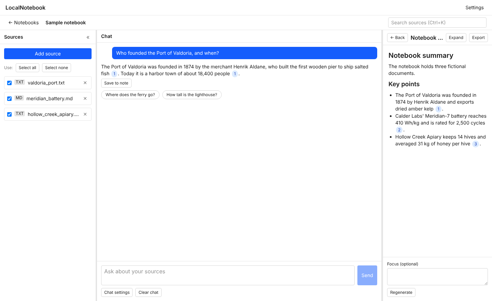
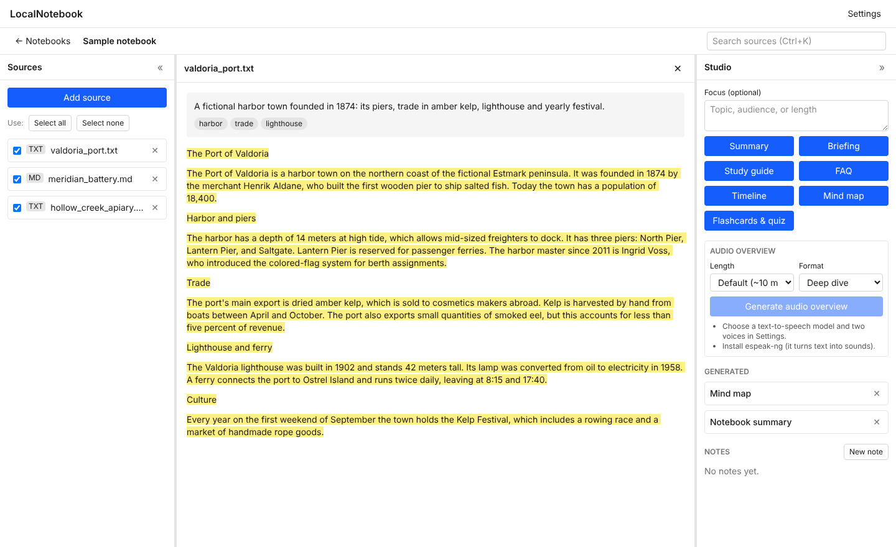
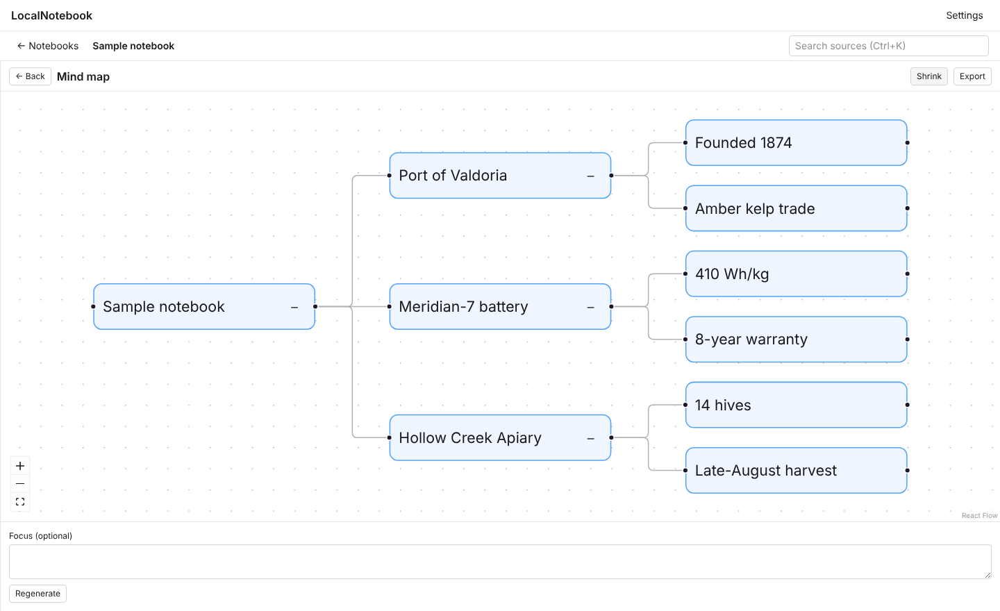

# LocalNotebook

**A private, local alternative to Google NotebookLM.** Add your documents, web pages and videos, ask
questions and get answers with citations that open the exact passage, and generate summaries, study
aids and two-host audio overviews. It all runs on your own computer with your own AI models (for
example through [Ollama](https://ollama.com)). No account, no cloud, no tracking.

[](https://github.com/peteyagmin/localnotebook/actions/workflows/ci.yml)
[](LICENSE)



*Independent project, not affiliated with or endorsed by Google. NotebookLM is a trademark of Google LLC.*

## What you can do

- **Chat with your sources.** Answers use only your sources, every claim has a numbered citation, and
  questions your sources cannot answer are declined instead of guessed.
- **Add almost anything:** PDF, Word, text, Markdown, HTML, EPUB, images and scanned pages (OCR), audio
  files (transcribed locally), web pages (saved, so they work offline), YouTube videos, or let
  **Discover** suggest sources on a topic.
- **Generate:** summaries, briefings, study guides, FAQs, timelines, mind maps, flashcards and quizzes,
  with exports to Markdown, Word, PDF, PNG, JSON and CSV.
- **Audio overviews:** a spoken discussion between two hosts (deep dive, brief, debate or critique)
  with a transcript that follows along, an editable script and re-synthesis.
- **Take notes, search everything** (`Ctrl/Cmd+K`), and **export or import** whole notebooks as one
  `.lnb` file.
- **Your data stays yours.** Everything lives in one folder on your computer. The app only uses the
  internet for actions you start (adding a web page, Discover, downloading a speech model), and each
  can be switched off.
- Light and dark themes, adjustable text size, full keyboard use, and an accessibility check in CI.

| | |
|-|-|
|  |  |
| *Click a citation to see the exact passage.* | *Generate and explore a mind map.* |

## Quick start

1. Install [uv](https://docs.astral.sh/uv/) and [Ollama](https://ollama.com/download), then download
   a chat model and an embedding model, for example `ollama pull llama3.1` and
   `ollama pull nomic-embed-text` (examples only; choose models that fit your computer).
2. Download the newest `LocalNotebook-v….zip` from the
   [Releases page](https://github.com/peteyagmin/localnotebook/releases) and unzip it.
3. In that folder, run `scripts/run.sh` (macOS / Linux) or `scripts\run.ps1` (Windows PowerShell).
   Your browser opens on the app; follow the setup checklist.

**New to this? Read the step-by-step [User Guide](docs/USER_GUIDE.md).**

## Requirements

- [uv](https://docs.astral.sh/uv/) (manages Python 3.11+)
- [Ollama](https://ollama.com) (or another OpenAI-compatible local server)
- Optional, checked by the setup checklist: Tesseract (images and scans), ffmpeg and espeak-ng
  (audio overviews)
- [Node.js](https://nodejs.org) 20+ and npm, only when running from the source code instead of a
  release zip
- Recommended hardware: 32 GB RAM and a GPU with 12 GB+ VRAM (or Apple Silicon with 32 GB). The
  minimum is 16 GB RAM and an 8-core CPU, where everything works but chat and audio are slow.

## Run from source

```
git clone https://github.com/peteyagmin/localnotebook.git
cd localnotebook
scripts/run.sh        # Windows: scripts\run.ps1
```

This builds the frontend on first run, starts the server on a free `127.0.0.1` port, and opens your
browser with a per-launch token. On first launch the setup wizard checks the model server, your chat
and embedding models, Tesseract, ffmpeg and espeak-ng.

Ingesting a source calls your model server twice (embeddings, then a short source guide), so a chat
model and an embedding model must be set in Settings first. Without them a source shows as failed
with a **Retry** button.

## Documentation

- [User Guide](docs/USER_GUIDE.md): installation, every feature, settings, troubleshooting
- [Specification](docs/PROJECT_SPEC.md): requirements and design decisions
- [Changelog](CHANGELOG.md), [Contributing](CONTRIBUTING.md), [Security](SECURITY.md)

## Known limitations (1.0)

- Audio overviews use a Kokoro ONNX voice engine that has had limited testing on real model files.
- Most testing has been on Linux; CI runs the tests on Linux, macOS and Windows.
- The grounding evaluation (`evals/run_eval.py`) is provided but has not been published for any
  particular model; run it against yours.
- Notebooks and exports are not encrypted.

## Develop

`scripts/dev.sh` / `scripts/dev.ps1`: backend with reload plus the Vite dev server.

### Test and lint

```
uv run pytest
uv run ruff check
cd frontend && npm test && npm run lint
```

End-to-end smoke test (QA-5; a real browser against the built UI and a fake model) and the
accessibility check:

```
cd frontend && npm install && npm run build   # once, and after UI changes
uv run pytest -m e2e
```

Performance check against spec section 9 (measures the app's own cost with a fake model; the
real-model parts are for you to measure on your hardware):

```
uv run python evals/perf_check.py
```

Regenerate the screenshots in `docs/screenshots` (needs the built frontend):

```
uv run python scripts/screenshots.py
```

## Web, video, audio, and OCR

- **Tesseract** (a separate program) is needed for images and scanned PDF pages. Without it the rest
  works, and the setup wizard and the Add source menu say so.
- **Audio and videos without captions** need a speech-to-text model: enter its name in Settings, then
  press **Download model** (it asks first and shows progress). Models live in your data folder.
- **Transcribe videos without captions** is off by default. Turning it on downloads only the audio,
  transcribes it on your computer, and deletes the audio. You are responsible for complying with the
  platform's terms of service.
- **Discover** needs your own [SearXNG](https://docs.searxng.org) address with JSON output enabled
  (Settings > Network). It suggests up to 10 pages or videos; nothing is imported until you tick them.
- Web addresses on this computer or your local network are always refused. Each kind of network use
  can be switched off in Settings > Network.

## Generated documents and large notebooks

Artifacts are written from all enabled sources. If they do not fit in your model's context window,
the app first condenses them in parts, then writes the document from those notes. Set **Model
context window (tokens)** in Settings to your model's real size (default 8000). PDF export uses a
system Unicode font when one is installed (DejaVu Sans, Arial); otherwise it uses a built-in
Latin-only font.

## Grounding evaluation (QA-4)

Run manually against a real model; it uses fictional documents so the model cannot answer from
memory:

```
uv run python evals/run_eval.py --chat-model <name> --embedding-model <name>
```

It asks 30 questions (15 answerable, 15 not) and prints a results table with two rates: citation
support (target 95%) and correct refusal (target 90%). `--selftest` checks the script itself with a
scripted model and needs no server.

## Configuration

- Defaults: `backend/app/config/defaults.toml`. Model names are empty until you set them in the
  wizard or Settings.
- Environment overrides: `LNB_DATA_ROOT`, `LNB_HOST_PORT`, `LNB_LLM_BASE_URL`.
- Data folder: the OS user-data directory for "LocalNotebook" (override with `LNB_DATA_ROOT`).

## License

MIT. Copyright (c) 2026 Pete Yagmin. See [LICENSE](LICENSE). Third-party components and their
licenses are listed in [THIRD_PARTY_LICENSES.md](THIRD_PARTY_LICENSES.md).
